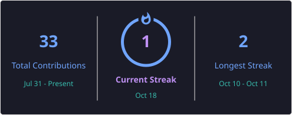

# Hi 👋, I'm Ananya Singh

### 🎓 Computer Science Student

💻 Passionate about **Software Development, Data Science & Artificial Intelligence**

🌱 **Currently Learning**
- Data Structures & Algorithms
- Artificial Intelligence & Machine Learning
- App Devlopment
- Data Analytics

🚀 **Working On**
- Open Source Contributions
- DSA Problem Solving
- Data Analytics

---

### 🤝 Connect with Me

  
  
  

## 💻 Tech Stack

<h3>💻 Languages & Technologies</h3>

  

<h3>🌐 Web Development</h3>

  

<h3>🗄️ Database</h3>

  

### 📊 Data Analytics

  
  
  

### 🛠️ Tools & Platforms

---

## 📊 GitHub Stats

  

  

  

---

## 🏆 GitHub Trophies

  

---

## 🐍 Contribution Snake

  <picture>
    <source
      media="(prefers-color-scheme: dark)"
      srcset="https://raw.githubusercontent.com/Ananyasingh0413/Ananyasingh0413/output/github-contribution-grid-snake-dark.svg">
    <source
      media="(prefers-color-scheme: light)"
      srcset="https://raw.githubusercontent.com/Ananyasingh0413/Ananyasingh0413/output/github-contribution-grid-snake.svg">
    
  </picture>

---

### ✨ Quote

> "Code. Learn. Build. Repeat."

⭐ If you like my work, consider following my profile.
